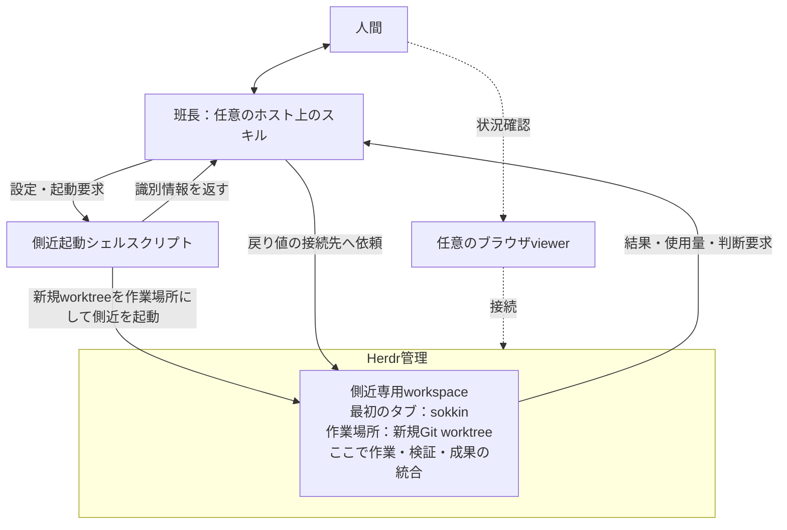

# Hanchou v2 設計書

作成日: 2026-10-20

状態: 設計案。必須要件と採用方針を定義する文書であり、実装済み・実機検証済みを意味しない。

## 1. 設計の結論

Hanchouを、実行環境に依存しない薄いスキルへ作り直す。班長は仕事を依頼し、結果を人間に伝え、使用量を監督する。作業の遂行はHerdr内の側近が担当する。

**新しい側近を起動するたびに、専用の新規Git worktreeと新規ブランチを先に作る。** この必須手順は小さな側近起動シェルスクリプトにまとめる。班長はスクリプトを呼び、作成されたworktree・Herdr workspace・側近の識別情報を戻り値で受け取って、その側近へ依頼する。

workspaceの最初のタブで起動する側近は、`.hanchou`内の設定でCodexまたはClaude Codeを選ぶ。側近はworkerのエージェント・モデルを選び、作業、検証、再試行、成果の取りまとめを行う。側近とworkerのプロセス管理をOrcaから外す。

この文書では、現在運用しているOrca中心のHanchouを比較上「v1」、今回の新設計を「v2」と呼ぶ。これは現行リポジトリのv3や過去のv2というリリース番号とは別の呼び方であり、連続性・互換性は前提にしない。既存のOrca Run／Task中心の仕様を維持する義務はなく、本書を承認しても現行スキルが自動的に切り替わるわけではない。

側近の英語識別子は`sokkin`に統一する。設定キー、戻り値、スクリプト名でも同じ表記を使う。

## 2. 目的と対象外

目的は、班長の長い常駐コンテキストと細かなworker監視を減らし、作業に応じてモデルを選べるようにすること、worker由来の通知を人間への報告に集約すること、そしてOrca以外からも使えるようにすることである。

階層化だけでトークン削減を保証しない。側近の追加コストも含め、同種の作業の完了率・品質・総使用量を比較して効果を評価する。

Hanchouの中心はスキルとする。新規worktree作成を確実に実行するための、単発で終了する側近起動シェルスクリプトを同梱する。スクリプトは既存のGit・Herdr・公式エージェントCLIの操作をまとめる。常駐runtime、daemon、DB、scheduler、汎用agent launcher、独自dashboardへは拡張しない。企業利用の可否は組織の導入・認証・データ取扱方針に依存し、Herdr採用だけで承認済みとは扱わない。

これは今回のユーザー指示に基づく、従来の「production code／launcherを追加しない」方針への限定的な変更である。実装段階では、この範囲に合わせてリポジトリ指針と検査を更新する。今回の文書更新ではスクリプト自体を追加しない。

Hermes等を将来の実行先候補から排除はしないが、初版はHerdrを対象とする。未実装の汎用backend層やplugin frameworkは作らない。

## 3. 必須要件

以下はv2の受入条件である。「未検証」は任意要件への格下げではなく、満たすまで対象機能を本運用に出さないことを意味する。

| ID | 必須要件 | 判定基準 |
| --- | --- | --- |
| R01 | スキルと薄い起動スクリプトで構成する | 単発のシェルスクリプトが既存ツールを操作し、独自の常駐サービスを追加しない |
| R02 | Orca非依存 | Orcaを起動していない環境から、依頼・実行・結果回収・使用量確認を完了できる |
| R03 | 起動スクリプトが新規worktreeと新規ブランチを必ず作る | 元のcheckoutと異なる実体パス、branch、固定した起点commitを検証し、その後に側近を起動する。作成・検証失敗時は起動しない |
| R04 | 人間の作業場所を変更しない | 元のbranchの切替・reset・stash・未コミット変更の移送・そこでの作業を行わない |
| R05 | 側近1人に専用Herdr workspaceを割り当てる | 最初のタブが側近。別の依頼の側近とworkspaceを共用せず、起動結果から操作対象を取得できる |
| R06 | 側近以下をHerdr管理下に置く | Orcaのworker起動・Run・通知基盤を必須にせず、viewerを閉じても実行を継続できる |
| R07 | `.hanchou`の設定から側近を選べる | Codex／Claude Codeと任意のmodelを指定でき、設定元と実際の起動結果を照合できる |
| R08 | エージェント単位で使用量を識別できる | mission、実行試行、provider、native thread/session、子エージェントの対応と計測対象範囲が確認できる |
| R09 | セッション使用量を欠測・重複込みで扱う | 入出力・cacheを区別し、再開・fork・子実行で二重計上しない。欠測は0にしない |
| R10 | 使用量を根拠に起動を制御する | 予算・並列数・再試行上限を設定し、上限到達や計測不能時は新たな処理の割当を止める |
| R11 | 承認済み範囲でモデルを自律選択する | 副作用、難度、検証結果、残予算をもとに選択し、選択理由と変更理由を残す |
| R12 | Claude Codeはサブスク経路に限定する | 公式CLIと本人の許可済み認証を使い、API課金・追加課金経路へ黙って切り替えない |
| R13 | 完了を成果で確認する | 待機状態だけで完了扱いせず、成果物、検証結果、未解決事項、使用量を回収する |
| R14 | 人間への通知を班長に集約する | 通常のworker進捗では通知せず、完了・判断要求・予算問題・継続不能を報告する |
| R15 | 成果を保全して解放する | プロセス停止、workspace閉鎖、worktree削除を分け、未保存の成果を消さない |

Git worktreeは作業場所の分離であり、ファイルアクセスの強制的な隔離ではない。Gitの管理情報も共有する。R04を守る指示・作業前後の照合に加え、親ディレクトリへの書込みを技術的に禁止する必要がある環境では、既存sandbox／権限制御を別途必須にする。

## 4. 構成と責務



新規worktreeは側近専用workspaceの作業場所であり、作業・検証・統合はHerdr内のsokkinが担当する。班長側へ別の統合環境を用意する構成ではない。図の枠は作業の管理範囲を示し、実ファイルは通常のGit worktreeとしてファイルシステム上に保存される。側近以下の配置の詳細はこの図で固定しない。

| 担当 | 責務 |
| --- | --- |
| 班長 | ①目的・完了条件・権限・予算を側近へ渡す。②側近の結果を整理し人間へ報告する。③使用量と残予算を確認し、継続・縮小・停止を判断する |
| 起動スクリプト | 設定検証、新規worktree作成、Herdr workspace作成、側近起動、起動情報の返却を一度実行して終了する。作業の分解・監督・継続的な会計は行わない |
| 側近 | 分解、workerとモデルの選択、配置、実行、検証、統合、再試行、予算内の完遂、班長への連絡を担当する |
| worker | 渡された範囲の作業と検証を行い、成果・問題・使用量の識別情報を側近へ返す |
| Herdr | 既存のworkspace／tab／paneとエージェントプロセスの操作・状態観測を提供する |
| 計測元 | 公式CLIの利用情報・ログ、必要に応じた既存の集計ツール。Herdrの画面表示を会計の正本にしない |
| ホスト | 班長との対話、ツール実行、利用可能な場合の復帰・通知・ブラウザ表示を提供する。Orcaはその一例 |

班長はworkerの個別ログを常時読み込まない。側近から要約と成果への参照を受け、問題を解くために必要な範囲だけ詳細を確認する。初版では側近がさらに側近を作る再帰的な構成を禁止し、並列数を有限にする。

## 5. 側近の設定と起動

### 5.1 `.hanchou`の設定

既存の`.hanchou/policy.md`は、人間が読む責務・権限・報告方針として継続する。機械が読む起動設定を`.hanchou/config.json`に追加する。設定はJSONのデータとして読み、シェルコードとして`source`や`eval`しない。

最小設定例:

```json
{
  "version": 2,
  "sokkin": {
    "agent": "codex",
    "model": null
  }
}
```

`sokkin.agent`は`codex`または`claude`とし、後者は公式Claude Codeを指す。`model`がnullまたは省略の場合はそのCLIの設定済み既定値を使い、要求した値と実際の値を区別して報告する。Claudeのサブスク限定要件は側近にもworkerにも適用し、設定でAPI課金へ解除する項目は設けない。任意の`sokkin.effort`には`low`・`medium`・`high`またはnullを指定できる。null／省略時はCLI既定値を使う。要求値と観測値を分け、対応しないmodel／effortで黙って別候補へ切り替えない。

設定元は、依頼で選んだ対象project rootに固定する。新しく作ったworktreeのcwdから別の`.hanchou`を自動探索しない。実行時に確定した設定と元pathを側近へ渡すため、Git管理外の`.hanchou`を新規worktreeへコピーする必要はない。既存のローカルpolicy運用と同様に、共有・Git管理するかは明示的な選択とし、認証情報は保存しない。

今回の依頼で明示された一時指定は設定値より優先するが、永続設定へ自動で書き戻さない。起動スクリプトは確定済み設定を受け取り検証する。設定未作成時は初期化でagentを選び、明示的な一時指定もないまま勝手に別agentを起動しない。壊れた設定や未対応agent／model指定は起動前にエラーとし、別providerへのfallbackを行わない。

### 5.2 新規依頼の起動順序

班長は対象・依頼・設定を確定し、スキルに同梱する`launch-sokkin.sh`を呼ぶ。以下の配置・起動処理はスクリプトにまとめ、新規worktree作成を省略するオプションは設けない。JSONの読取り・生成には`jq`を使い、文字列連結でJSONや実行コマンドを組み立てない。引数を適切に引用して既存CLIへ渡す。対応shellはBash 3.2以上とし、依存ツールは資源作成前に検証する。起動処理にPython／TypeScriptの実行環境は要求しない。

1. 対象repository、実行host、起点commit、作業目的、権限、使用量予算を確定する。元のcheckoutのbranch・HEAD・差分状態を観測する。
2. 一意なmission IDを付け、既存branch／既存directoryを再利用せず、新しいbranchとGit worktreeを作る。起点は動くbranch名だけでなくcommit IDとして固定する。
3. `git worktree list`等の既存Git機能で登録されたpath、branch、HEAD、共通Git directoryを照合する。記録上の親依頼と実際の起点も一致させる。異なるpathだけで正しいrepository由来とは判断しない。
4. 新規worktreeをcwdとしてHerdr workspaceを作り、返されたworkspace／tab／pane IDを使う。初期タブに設定された公式CLIで側近を起動する。
5. 実際のcwd・branch・HEAD、起動したagent、取得できたnative thread/session IDを照合し、起動結果を返してスクリプトを終了する。native IDの取得が未完了ならその事実を返し、使用量の計測準備まで完了したとは扱わない。
6. 班長は戻り値を使って側近の受領と計測可能性を確認してから実作業を渡す。起動時点からの使用量も含める。任意のviewerを開く場合も、返された接続先を使う。

Herdrはworkspace作成時に最初のtab／paneを作成し、`agent start`は既存paneを使う。この公開契約に沿って操作し、CLIの結果からIDを取得する。コマンド構文は導入した版のhelpを参照する。[Herdr agent automation](https://herdr.dev/docs/agent-automation/)

途中失敗したら、元のcheckoutで代替実行しない。新規作成物のうち所有と状態を確認できるものだけを後片付けし、起動済みか不明なプロセスを二重起動しない。

### 5.3 起動スクリプトの戻り値

stdoutにバージョン付きJSONを1件返し、診断ログはstderrへ分ける。班長が自然文の起動ログからpathやIDを推測する必要をなくす。以下はHanchou側で定義する戻り値案であり、Herdrの既存レスポンス形式そのものではない。

| 項目 | 内容 |
| --- | --- |
| `version`, `missionId`, `attemptId` | 返却形式の版、依頼と今回の起動試行の識別子 |
| `ok`, `stage` | 起動処理の成否と到達段階。agent readyは仕事の完了や計測準備完了を意味しない |
| `config` | 設定元pathと今回適用した設定。認証情報を含めない |
| `worktree` | 実path、branch、固定base commit、起動時HEAD、元repositoryの識別情報 |
| `herdr` | host／serverの接続先、workspace／tab／pane ID。共有server全体への所有権は意味しない |
| `sokkin` | agent種別、実行名、要求modelと観測できたmodel、native thread/session ID。未取得値はnull |
| `usageReadiness` | 計測準備の`ready`／`pending`／`unavailable`と理由。token値自体の正本にはしない |
| `error`, `resources` | 失敗理由、今回作った資源と残存・削除済み・状態不明の区別。成功時も作成対象を特定できる情報を返す |

班長はこの戻り値の接続先に対して依頼・状態取得・結果回収を行う。側近起動後、スクリプトは常駐しない。起動完了・計測準備完了の両方が確認できるまでは実作業を送らない。

事前検証で失敗した場合は資源を作らない。部分失敗では作成済み資源を残して識別情報を返す。起動スクリプト内で自動削除せず、班長が所有・実稼働・成果を照合して回収する。班長は失敗結果を照合せずに同じ起動を再送しない。強制終了で戻り値自体を失った場合は、試行IDと既存Git／Herdrの状態を照合する。永続DBによる完全な再実行保証までは持たせない。

### 5.4 再開

側近以下の配置やworktree作成の要否は側近に委ね、本書でworkerのworktree・tab・workspace構成を固定しない。

同じ生存中の側近へ追加指示を送ることは新規起動ではない。新しい側近への置換・再起動では、再試行でも新規worktree／branchを作成し、保全した成果を明示的に引き継ぐ。停止した側近を古いcheckout上で自動復活させる例外は設けない。viewerの再接続はエージェント起動ではない。

## 6. 班長と側近の連携

スキルで以下の文書形式を定める。専用API、永続queue、Hanchou独自DBを実装することを意味しない。依頼と報告は既存のファイル・会話に残し、Herdrには接続先を照合する最小限の識別情報を持たせる。

| 文書 | 必須項目 |
| --- | --- |
| 依頼 | mission ID、試行ID、目的、完了条件、対象repo／host／固定base、禁止事項、成果の保存先、許可するエージェント・モデル・認証経路、予算、並列・再試行上限 |
| 受領 | 同じmission／試行ID、workspace／pane、実path・branch・HEAD、providerとnative thread/session、計測元、理解した完了条件 |
| 中間報告 | 状態、進捗の要約、成果の参照、自己使用量とworker合計、計測時刻・欠測、残予算、次の処理、必要なら判断要求 |
| 完了報告 | 完了条件ごとの結果、commit／diff／成果物、実行した検証、未解決事項、使用量の内訳、停止確認、保全・解放可否 |

接続先はhost／Herdr server／workspace／paneとnative実行IDを組にして扱う。表示名だけで送信先を決めない。Codexではsession IDを共有するthread群があるため、個別実行の識別にはthread IDを使い、親子関係を別に持つ。

依頼の状態は「準備→起動→受領→作業→検証→報告済み→受入済み→解放」とし、途中から「判断待ち」「予算停止」「実行状態不明」へ遷移できる。班長は目的を再送する前に受領済みか照合する。

Herdrの待機状態や`agent prompt --wait`だけでは、その依頼の完了を証明できない。timeoutでも入力済みの場合があるため、報告ID・実行状態を読んでから再送を判断する。依頼には一意IDを付けるが、厳密なexactly-once実行をスキルだけで保証するとはしない。[Herdr agent automation](https://herdr.dev/docs/agent-automation/)

## 7. セッション使用量の計測

### 7.1 本運用の前提

**CodexとClaude Codeのセッション使用量を安定して取得できることを、v2の最初の導入判定にする。** Herdrで起動できることだけを確認して先へ進めない。副作用のない小さな試験で計測・親子対応・重複除去を確認してから、自律的なworker起動を有効にする。

「API上のトークン数」「サブスクの利用枠消費率」「API価格換算額」は別の指標である。週次利用枠が50%減ったことを、あるセッションのトークン数へ正確に配賦できるとは限らない。トークン数から週次残量を独自換算しない。

### 7.2 計測元と確認状況

| 対象 | 初版の候補 | 調査で確認したこと／残る確認 |
| --- | --- | --- |
| Codex | native threadに対応する利用記録。必要に応じ既存ログ集計ツール | 手元のCLI 0.162.1のログにresponse単位・thread累計の記録があった。安定した2 threadで一意responseの合計と最終累計が一致。全ケースへの保証ではない |
| Codex公式API | app-serverのusage通知・usage取得 | 公開schemaにthread利用情報がある。一方、既存CLI threadへの読取り試験では`threadUsage: null`であり、APIだけで全実行を取得できるとは確認できていない |
| Claude Code | native sessionのログ集計。将来は公式OpenTelemetryも候補 | 手元のCLI 2.1.299のログで同一requestのusageが複数行に重複した。request/message単位の識別が必要。内部ログ形式への依存は版ごとの検証が必要 |
| Claude公式telemetry | 起動前に設定したOpenTelemetryのrequestイベント／metrics | セッション別計測の公式手段。ただし収集先の運用が必要。Hanchou独自collectorは作らず、既存の採用済み基盤がある環境で検証する |
| ccusage | provider別sessionのJSON集計 | 既存ツール候補。今回の環境では未導入・未実行。採用版を固定して照合試験を行うまで受入済みとしない |
| Herdrのmetadata／viewerの使用量表示 | 表示・参考情報 | セッション会計の正本として採用しない。account単位の表示をpane単位の使用量と誤認しない |

Codexの公開インターフェースは[App Server資料](https://learn.chatgpt.com/docs/app-server)、Claudeのtelemetryは[Monitoring資料](https://code.claude.com/docs/en/monitoring-usage)、集計ツール候補は[ccusage Codex](https://ccusage.com/guide/codex/)・[Claude](https://ccusage.com/guide/claude/)を参照する。手元の観測はローカル試料の確認であり、providerの課金仕様の保証ではない。

### 7.3 集計契約

各記録にはmission／試行／worker、provider、native ID、親ID、model、計測元と版、観測時刻、対象期間、完全性を付ける。完全性は少なくとも「対象範囲を取得」「一部欠測」「不明」を区別する。生の本文や認証情報は報告へ載せない。

| 論点 | 集計ルール |
| --- | --- |
| 累積値と差分 | 累積値を時系列で足さない。request単位の一意記録と累積値を混ぜて合算しない。更新途上の値の不一致は鮮度を確認する |
| Codexのcache／reasoning | cached inputはinputの内数、reasoning outputはoutputの内数として扱い、再加算しない。追加フィールドは採用版の意味を検証する |
| Claudeのcache | 通常input、cache creation、cache read、outputを分けて保持する。通常inputにcacheが含まれる前提で共通式を使わない |
| 重複 | provider固有のrequest／response／message識別子で除去する。同じ本文かどうかで判定しない |
| fork・resume・compaction | コピーされた過去の記録を新しい消費と数えない。再開でcounterやsequenceがリセットする場合を扱う。追加の圧縮処理も測定対象に含める |
| 子エージェント | 子の全requestを対象とする。親の累計が子を含むか確認し、親子の単純加算を避ける。帰属不能な処理は未配賦として残す |
| mission合計 | 班長の当該依頼分＋側近＋全worker＋再試行・補助処理。班長分を分離できなければ「側近以下の小計」と明示する |
| 最終報告 | 入出力・cache内訳と、計測範囲・欠測・最終観測時刻を必ず添える。推定額は支払額やサブスク枠消費率と呼ばない |

Claudeの公式telemetryでも、子処理の完了イベントの`total_tokens`を子の全履歴合計と見なさない。requestイベントとmetricsの二重集計や、resume後のsequence再使用を避ける必要がある。[Claude Monitoring](https://code.claude.com/docs/en/monitoring-usage)

計測不能・対応するnative IDが不明・許容鮮度を超えた場合、側近は新規worker・追加依頼・自動再試行を止めて班長へ報告する。起動前に許容する計測遅延と欠測時の扱いを決める。すでに進行中のrequestを厳密なトークン境界で止める保証はしない。

## 8. モデル選択と予算

側近自身のagent／modelは`.hanchou/config.json`と今回の明示的な指定で決める。側近がworkerを選ぶ方針はこれと分け、すべての仕事に側近と同じmodelを適用しない。モデル名は設計書へ恒久的に埋め込まず、環境で使える承認済み候補、認証経路、品質条件、推論設定を依頼時のpolicyとして渡す。

| 作業 | 選択方針 |
| --- | --- |
| 定型の小変更・既知手順 | 許可された候補から、必要な品質を満たす低消費の設定を選ぶ |
| 原因不明の障害・複雑な設計・検証失敗 | 問題を限定してから、理由を添えて上位候補へ切り替える |
| レビュー | リスクと差分量に応じて必要な範囲だけ独立検証する。全タスクへの多重レビューを標準にしない |
| 予算不足・rate limit | 並列数やscopeを縮小するか停止する。別providerや有料経路への切替で上限を迂回しない |

予算には、mission総量の目安、workerごとの割当、並列数、再試行回数、最終検証・報告用の留保を含める。側近が制御できる依頼の送信前後・worker追加前・再試行前・統合前に確認する。worker内部の個々のAPI requestをスキルが横取りして制限できるとはしない。短周期のLLMポーリングで監視コストを増やさない。実行中の監視を使う場合は、既存ツールの待機や通知能力で実現できる範囲を明記する。

Claude Codeは公式CLIのサブスク認証を利用する。API keyや追加利用への自動fallbackを禁止し、認証経路を確認できない環境では起動しない。OAuth資格情報を抽出して別のagent libraryへ渡さない。公式CLIを使う場合でも、適用される利用条件と組織方針の確認は必要である。[Claude Code Legal and compliance](https://code.claude.com/docs/en/legal-and-compliance)

週次／時間枠の利用率が公式の経路で取得できる場合は、トークン数とは別に観測時刻付きで表示する。他の会話による利用も混ざるため、missionへの正確な帰属は主張しない。取得できない値は「不明」とする。

## 9. 通知とviewer

旧版には任意の静的状況ビューのテンプレート`skills/hanchou-orchestrator/assets/status-view.html`と更新手順があり、調査時点では対象projectの`.hanchou/index.html`も存在する。旧テンプレートは自動更新されるライブdashboardではなく、v2の配布から削除する。**v2では班長独自の状況ビューを対象外とし、生成・更新・移行を必須にしない。** 利用者が生成済みのファイルは自動削除しない。以下のHerdr viewerはこの状況ビューとは別の任意機能である。

人間への通常の窓口は班長とする。側近からの細かな進捗、workerの開始・終了、試行ごとのログは集約し、完了、判断が必要な事象、予算問題、継続不能を報告する。重複した状態変化で繰り返し通知しない。

Orcaのworkerとして起動しないことで、その経路の通知を構成から外す。ただしOS、Herdr、公式CLI、ブラウザ各自の通知設定は別であり、完全な無通知は実機確認なしに約束しない。

ブラウザ表示には既存の[herdr-web-ui](https://github.com/devswha/herdr-web-ui/blob/main/docs/guide.md)を候補とする。これはHerdr本体と別の第三者pluginであり、初版の必須依存にはしない。Orcaでは新しいブラウザタブ、他ホストでは通常のブラウザ等で表示する。workspaceを直接開く方法・導入手順・組織の許可は未検証である。

viewerを閉じることと、Herdr側の仕事を止めることを分離する。viewerに入力・承認機能がある場合、「閲覧用途」と「技術的なread-only」を混同しない。Hanchou独自のviewerは作らない。

初版は班長の呼出しが継続している間の待機・結果回収を基本にする。班長の会話が終了した後も側近が動くことと、完了時に班長を自動起床させられることは別である。後者はホストの復帰機能・既存通知基盤が必要で、どのホストでも同じ非同期通知ができるとはしない。

## 10. 保全と解放

標準は、成果を受け入れた後の明示的な解放とする。解放の手順は次の順序で行う。

1. 側近・workerの結果、検証、最終使用量、未解決事項を回収する。
2. 成果をcommit、成果ファイル等として保全する。会話・viewer・一時worktreeだけを唯一の保存先にしない。
3. 解放範囲に属するプロセスを停止し、実際の停止を確認する。接続不能を停止成功と扱わない。
4. Herdr workspaceを閉じる。workspace閉鎖とGit checkout削除を別の操作として扱う。
5. 保全済みで不要と確認したworktreeのみ削除する。dirty／untrackedを強制破棄しない。branch削除は別途、保全・統合状態を確認する。

Herdrでもworkspaceの閉鎖とworktreeの削除は別の操作である。実際の削除挙動は採用版の公開契約を確認する。[Herdr CLI reference](https://herdr.dev/docs/cli-reference/)

「最後の作業から24時間で自動解放」は初版の必須要件にしない。採用する場合は、受入済み、成果保全済み、実行中でない、保留理由がないことを条件とし、最終操作時刻だけで削除しない。既存の外部schedulerと所有者・保持理由・次回確認日が必要である。本書はcronの作成・有効化を指示するものではない。

## 11. 実現可能性と残る制約

| 項目 | 現時点の判定 | 本運用までに必要なこと |
| --- | --- | --- |
| Herdr workspaceの最初のタブに設定された側近を置く | 両CLIの起動とbootstrapを実機確認。詳しくは[検証状況](VALIDATION.md) | Codex／Claude Codeそれぞれで新規起動・受領・終了を通す |
| 側近起動シェルスクリプト | Bash 3.2対応で実装、異常系を試験 | 対応shellと依存ツールの確認、設定検証、戻り値、途中失敗・二重起動防止の試験 |
| `.hanchou`の側近設定 | 設定検証と起動時overrideを実装 | 設定元の固定、一時指定、未対応設定の拒否、実際のagent／modelとの照合 |
| 新規worktreeへの配置と元branchの維持 | 既存Gitで実現可能 | 失敗・dirty親・並列・再起動の試験、起動後cwd確認 |
| Orca非依存の操作 | 設計上可能 | Orcaを停止した環境で全経路を通す |
| Codex／Claudeのセッション集計 | ローカル試料で部分確認 | native IDの取得、採用集計ツール、子・再開・fork・圧縮・欠測の受入試験。未完了ならR08–R10未達 |
| Claudeのサブスク限定運用 | 採用環境での認証確認が必要 | Herdr起動時も公式認証が使われ、API／追加課金へfallbackしないことを確認 |
| モデル自律選択と割当停止 | スキルで方針化可能 | 選択できる候補と使用量データを接続し、停止・昇格条件を試験 |
| 週次枠消費のセッション別正確な配賦 | 現時点で保証できない | providerが必要な会計情報を提供しない限り、token内訳とaccount枠を別表示 |
| 厳密なトークン上限での即時停止 | スキルだけでは保証できない | provider／既存runtimeの強制上限が必要。初版は観測後の追加割当停止 |
| 全ホストでの自動復帰・非同期通知 | 共通には保証できない | ホスト別の既存復帰機能。未対応ホストは継続中の待機・再照会 |
| プロセス／server障害からの完全自動復旧 | 保証しない | 実行ID・成果・計測の再照合。画面の復元だけを実行再開と見なさない |
| viewerの自動表示・read-only化 | 任意機能、未検証 | plugin導入、対象workspace表示、権限・認証・ブラウザ連携の確認 |
| 24時間後の自動解放 | 初版対象外 | 既存scheduler、保持条件、誤削除防止の別設計 |

Herdrの状態復元や接続機能の詳細は[Session state and restore](https://herdr.dev/docs/session-state/)を参照する。表示の復元、エージェントの会話再開、未完了作業の安全な再実行はそれぞれ別に検証する。

## 12. 導入順序と受入試験

### 第1段階: 計測を成立させる

Codexとサブスク認証のClaude Codeを小さな試験で起動し、native IDと使用量の対応を確認する。通常実行だけでなく、同一requestの重複、resume、fork、子エージェント、compaction、中断、ログ更新途中、欠測を確認する。親子で二重計上しないことと、不明値を0にしないことを合否条件にする。失敗したproviderの自律起動は解禁しない。

### 第2段階: 班長と側近を接続する

班長が起動シェルスクリプトを一度呼び、新規worktree→専用workspace→設定された側近のタブ→JSONの戻り値→受領→成果報告→使用量確認を一巡させる。Codex／Claude Codeの設定をそれぞれ試し、元checkoutがdirtyでもその内容を移送・変更しないこと、Herdr起動失敗時に元checkoutで実行しないこと、timeout後に二重依頼しないことを確認する。

さらに、設定の欠損・不正値・一時指定、native ID取得待ち、各作成段階の部分失敗、戻り値を失った中断を試験する。起動スクリプトが終了した後も側近がHerdr上で動き、班長が戻り値を使って操作できることを確認する。

元checkout保全の試験には、人間役がファイル・staged hunk・untracked成果を並行変更するケース、統合操作と共有refへの影響、途中のコマンド対象の確認を含める。開始・終了時のsnapshot一致だけで保全を認定せず、人間の変更や帰属不明な差分を勝手に巻き戻さない。これは既存Issue #40の残件から引き継ぐR03・R04の受入条件である。

### 第3段階: workerと予算を追加する

側近に作業を依頼し、側近が分解・配置・モデル選択・統合を担当することを確認する。予算到達、計測欠測、再試行上限で新規割当が止まり、成果を保全して班長に戻ることを確認する。

### 第4段階: ホスト非依存と運用を確認する

Orcaを停止した状態で一連の操作を通す。viewerの有無で作業継続が変わらないこと、班長への報告が集約されること、未保存成果を残したまま削除しないことを確認する。同種の作業について、班長・側近・workerを含む総使用量と完了品質を比較する。

初版の出荷条件はR01–R15の受入確認である。単にスキル文面を書き換えたことや、リポジトリの`make check`が通ったことを、実行環境を含む受入確認の代替にしない。

## 13. 実装時の変更範囲

本書に沿って変更するものは、班長のスキル、側近起動シェルスクリプト、`.hanchou/config.json`の定義と初期化手順、側近へ渡す指示、依頼・報告の形式、既存ツールの使い方に関する最小限の参照、受入用テストである。既存のOrca必須起動、Run／Task前提、workerへの直接介入を新設計へ置き換える。旧仕様への互換層は要求しない。現行のproduction code禁止に関する指針・検査は、単発の起動スクリプトを許す範囲に限定して更新する。

v2実装として4スキルと起動スクリプトへ置換し、旧配布物と検査を削除する。既存利用者のインストールや稼働資源は別の移行対象である。実施済み検証と出荷までの残件は[検証状況](VALIDATION.md)を正本とし、設計上の必須要件と実機で確認済みの範囲を区別する。

## 14. v1から活かすもの・簡素化するもの・捨てるもの

引き継ぐ単位は、役立つ判断基準と受入条件である。v1のスキル本文・参照文書・Orcaの操作手順を、そのままv2の常時コンテキストへ移さない。「捨てる」はv2初版の配布・実行経路から外すことであり、既存利用者のファイル・成果・実行中の資源を削除する意味ではない。

### 14.1 活かすもの

| v1の要素・参照元 | v2で活かす形 | 残す理由 |
| --- | --- | --- |
| 明示的な起動と非侵襲的な導入（[導入](INSTALLATION.md)） | インストールや設定だけでは実作業を始めない。通常のagent利用とHanchou利用を分ける | ホストが変わっても意図しない起動を避けるために必要 |
| `.hanchou/policy.md`の責務・権限（[初期化](https://github.com/ykawase1011/hanchou/blob/9e2e4f9/docs/INITIALIZATION.md)） | 読む元を固定し、今回の依頼の権限と合わせてsokkinへ渡す。許可済みの内容を繰り返し質問しない | 自律実行の範囲を短い文書で共有できる |
| 実行先と実結果の照合（[証拠・権限の受入](https://github.com/ykawase1011/hanchou/blob/9e2e4f9/docs/POLICY_ACCEPTANCE.md)） | 起動要求、入力受領、実稼働、成果、停止を区別する。未知の状態は未知として返す | Herdrに移しても二重起動や誤った完了報告は起こり得る |
| 元checkoutと成果の保全（[#40](https://github.com/ykawase1011/hanchou/issues/40)） | sokkin起動前の新規worktree、元branch・index・人間の変更の保護、部分失敗からの回収 | 今回の必須要件そのものであり、Orca固有ではない |
| 秘密情報を出力へ載せない判断（[秘密情報の受入](https://github.com/ykawase1011/hanchou/blob/9e2e4f9/docs/SECRET_INPUT_VALIDATION.md)） | 設定・戻り値・使用量報告から認証情報と不要な本文を除く。必要な作業だけに情報を渡す | agentやホストの変更で弱めてよい性質ではない |
| 不明結果からの再試行と成果保全（[再利用の受入](https://github.com/ykawase1011/hanchou/blob/9e2e4f9/docs/WORKER_REUSE_VALIDATION.md)） | 再送前に元の試行を照合する。未コミット成果・実行中処理を保全する | timeoutと未実行を取り違えないために必要。Orca固有のhandle判定は持ち込まない |
| 検証済み範囲を限定する報告（[QA受入](https://github.com/ykawase1011/hanchou/blob/9e2e4f9/docs/QA_READINESS_VALIDATION.md)） | スクリプト試験、指示の評価、実機での業務成功を分ける | v1のテスト成功をv2の動作保証へ流用しないため |

### 14.2 簡素化して活かすもの

| v1の要素・参照元 | v2での変更 | 簡素化する理由 |
| --- | --- | --- |
| 班長による分解・委任・レビュー・統合（[構成](https://github.com/ykawase1011/hanchou/blob/9e2e4f9/docs/ARCHITECTURE.md)） | 作業遂行をsokkinへ移し、班長は依頼・結果報告・使用量監督に集中する | 班長が全workerの会話と細かな状態を抱えると、階層を増やしても消費が減らない |
| model／effort方針（[モデル選択の受入](https://github.com/ykawase1011/hanchou/blob/9e2e4f9/docs/MODEL_ROUTING_VALIDATION.md)） | 方針の適用範囲と要求値／実際値の区別は残す。承認済み候補内の選択をsokkinに任せ、使用量を判断材料にする | 毎回人間へ選択を戻す運用や、親の高コスト設定を一律継承する運用を避ける |
| `hanchou-init`（[初期化](https://github.com/ykawase1011/hanchou/blob/9e2e4f9/docs/INITIALIZATION.md)） | policyに加え、`config.json`の`sokkin.agent`・modelを設定できるようにする | 人間向け方針と機械向け起動値を分けると、起動スクリプトが短くなる |
| レビュー・browser QA・データ移行QA（[受入方針](https://github.com/ykawase1011/hanchou/blob/9e2e4f9/docs/POLICY_ACCEPTANCE.md)） | 必要な案件でsokkinが該当する手順を参照する。全依頼の必須読込にはしない | 作業種別ごとの専門手順を班長の基本動作へ常に積み増さない |
| 通知集約（[#10](https://github.com/ykawase1011/hanchou/issues/10)、[#22](https://github.com/ykawase1011/hanchou/issues/22)） | 重要な変化だけを人間へ報告する方針を残し、Orca Inboxを経由しないsokkinとの連携に置き換える | 通知問題は残るが、旧配送機構を再現する必要はない |
| 成果保全とcleanup（[受入方針](https://github.com/ykawase1011/hanchou/blob/9e2e4f9/docs/POLICY_ACCEPTANCE.md)） | 所有と成果を確認して解放する基準を残し、sokkinの起動結果とHerdr／Gitの実状態を使う | Run／Dispatch／terminal別の旧分岐を持ち込まずに、必要な保全を維持できる |
| 対象を限定した更新（[更新の検証](https://github.com/ykawase1011/hanchou/blob/9e2e4f9/docs/UPDATE_VALIDATION.md)） | 明示的な更新、導入先・local変更・版の確認を残す。更新版の採用は次の明示的な起動時に確認する | ファイル更新に、現ホストの会話終了と完全自動交代を必ず結び付けると複雑になる |

### 14.3 v2初版では捨てるもの

| v1の要素 | 判断と理由 | 代わりに残すもの／将来の扱い |
| --- | --- | --- |
| Orca Run／Task／Dispatch／DAG／gateを必須とする構成 | **Orca依存のため廃止。** Herdrと並行して管理すると状態・所有権が二重になる | mission／attemptと起動結果、依頼・報告という最小限の対応関係 |
| Run Inbox、Delivery全件処理、ack／drainとcoordinator loop | **旧配送機構への依存のため廃止。** 独自queueとして再実装もしない | 依頼の受領・重要な判断・結果回収の確認。ホストの復帰機能は任意 |
| Orcaの全役割・全起動経路へのchild lineage検証 | **旧配置体系への依存と複雑さのため廃止。** v2製品の配置条件をOrcaの親子IDで表さない | sokkin起動スクリプトによる新規worktreeと実path／branch／repo確認 |
| Orca structured／PTY workerの再利用・release分岐 | **旧endpoint固有のため廃止。** Herdrの対応能力を個別に検証する | 不明結果を再送しないこと、置換時の保全・停止確認 |
| `hanchou-cron`とOrca Automations設定・履歴管理 | **Orca依存のため初版から外す。** 汎用schedulerへの移植もしない | 定期実行や24時間解放は将来の別設計。既存運用の終了・引継ぎは移行作業として残る |
| 会話終了後に同じ会話・同じRunを必ず起こす契約 | **全ホスト共通化が困難なため初版から外す。** sokkinの継続実行と班長の自動復帰を分ける | 自動復帰なしでも使える待機・再照会。完全な無人継続は実現済みと扱わない |
| 起動・依頼のたびの自動更新確認と新タブへの自動交代 | **ホスト依存と状態移譲の複雑さのため初版から外す。** タブ可視化・old-self closeを基本依存にしない | 明示的な対象限定更新と次の起動時の版確認 |
| 班長独自の静的状況ビュー | **表示・更新担当・同期の責務を減らすため外す。** 既存HTMLの自動移行も行わない | 人間への報告と任意のHerdr viewer |
| 常時の改善メモ収集、公開receipt管理を含む改善サイクル | **本筋と別の状態管理を増やすためcoreから外す。** `hanchou-kaizen`／`hanchou-publish-issues`をv2の必須helperにしない | 既存メモは保全し、必要時に明示的な記録・起票を行う。外部公開の権限・秘匿化は維持 |
| Project／Cross-project／Temporaryという起動モードと複数Run管理 | **初版の設定・分岐を減らすため統合。** まず対象repoが明確な依頼として扱う | 異なる依頼を勝手に統合しない基準。複数repoの統括を第一版の出荷条件にしない |
| v1の全参照文書・互換表・受入マトリクスの一括移植 | **文量・旧例外・依存を持ち込むため行わない。** 過去のPASSを引き継がない | 有効な試験観点だけをv2用へ書き直す。旧資料は履歴として参照可能にする |

ここで外すのはv2の機能であり、ユーザーのGit履歴、未解決事項、設定、秘密情報保護、成果保全ではない。v1用の運用とv2用の製品受入を分けて整理する。

## 15. v2移行に伴うIssueの整理とクローズ条件

2026-10-20に`ykawase1011/hanchou`のOPEN Issue全7件をGitHubで確認した。以下はその時点の本文と追記を踏まえた方針である。現在の設計書作成ではIssueのclose・編集・投稿は行わず、移行時に各条件を照合する。v1で使っているOrca自体の障害がv2設計によって修正されたとは扱わない。

### 15.1 分類と推奨判断

| Issue | v2での扱い | クローズの条件と理由 |
| --- | --- | --- |
| [#13 同じHanchouへの会話終了後の自動復帰](https://github.com/ykawase1011/hanchou/issues/13) | **初版の対象外としてclose候補** | 同一会話・同一Runの自動復帰を初版から外す決定を移行版へ反映し、待機・再照会という代替と無人継続の制約を明記したら`not planned`。Herdrでsokkinが動き続けるだけでは元要件の完了ではない |
| [#39 Automationの実行先設定の不一致](https://github.com/ykawase1011/hanchou/issues/39) | **旧依存の廃止としてclose候補** | v2でOrca Automationsを使わず、影響を受けるv1運用を終了するか、明示した別の維持担当へ引き継いだら`not planned`。Orcaの設定不一致そのものは修正済みとしない |
| [#44 更新確認と新セッションへの安全な引き継ぎ](https://github.com/ykawase1011/hanchou/issues/44) | **過剰な自動化を外すためclose候補** | 明示的更新・次回起動時の版確認へ簡素化し、ホストの旧会話を閉じる完全自動交代を初版から外したら`not planned`。既存PR #45／#46の成果を否定せず、未完のE2Eを完了扱いにしない |
| [#40 子worktree配置と元checkout保全の実機受入](https://github.com/ykawase1011/hanchou/issues/40) | **残す要件をv2へ移す。今すぐは閉じない** | Orca固有の配置マトリクスを廃止し、元checkout保全の残件をR03・R04と第12節へ引き継ぐ。旧Issueをcloseするなら、具体的な後継追跡先と未実施ケースを先に残して`not planned`。同じIssueをv2受入へ改題・再定義する場合は、実機試験が通るまでOPEN |
| [#41 無人起動・失敗時のタブ増殖](https://github.com/ykawase1011/hanchou/issues/41) | **既存運用の問題として保留** | cronを捨てるだけでは残存端末は消えない。既存運用の停止／移管、所有者・唯一の成果・残存資源の照合、回収または保持理由と担当の確定が必要。運用終了・移管で旧開発課題を終える場合は`not planned`。原因修正や回収完了を意味するcloseとは区別する |
| [#10 workerのモバイル／OS通知集約](https://github.com/ykawase1011/hanchou/issues/10) | **v2でも解決すべき問題として維持** | R14・第9節のv2経路で、通常通知が増えず判断要求・障害・全体完了が失われないことを実機確認する。対象をv2経路へ明示的に更新して受入できたら`completed`。旧Orca経路のIssueとして終了させるなら、v2追跡先を残して`not planned` |
| [#22 内部Inbox通知と空確認の実況](https://github.com/ykawase1011/hanchou/issues/22) | **v2の報告品質として維持** | 旧Inbox処理は外すが、no-opの確認が会話を埋めず、実際の質問・障害・ユーザーの明示照会を落とさないことを確認する。対象をv2へ更新して受入できたら`completed`。旧経路廃止だけなら後継追跡を付けた`not planned` |

推奨は、**#13・#39・#44を機能廃止に伴う整理候補とし、#40は受入条件の移管、#41は既存運用の収束、#10・#22はv2での問題解消を待つ**ことである。7件を一括で「解決済み」にしない。#39の旧運用条件と#41の運用問題は関連するため、同じ引継ぎ証拠を参照してよい。

### 15.2 取り落とさない残件

[#40の本文](https://github.com/ykawase1011/hanchou/issues/40)には、元checkoutに人間が並行変更するケース、統合時の共有ref、途中の操作対象の確認が追加されている。これはOrcaを外しても必要であり、第12節へ引き継いだ。単に「新規worktreeを作れた」だけでcloseしない。

[#41の2026-10-20の追記](https://github.com/ykawase1011/hanchou/issues/41#issuecomment-6281243255)は、連続9回分の端末に認証入力要求が残存したと報告している。本設計の調査ではその端末の現在状態を再確認していない。最新の運用状態を別途確認し、設計書やIssueのcloseを停止・回収の代わりにしない。本文中の過去の「停止中」という記述だけで現在も停止中と推測しない。

[#44の追記](https://github.com/ykawase1011/hanchou/issues/44#issuecomment-6183209029)ではPR #46のマージが完了している一方、導入済みスキルへの反映・旧会話終了等の受入が残っている。廃止するのは残る完全自動交代の要求であり、未マージと誤認して再実装することではない。

### 15.3 close時に残す記録

close直前にIssue本文・最新コメント・関連PRの状態を読み直す。各Issueに、次の短い記録を残してから理由を選ぶ。

1. 何を終了するか：実装完了、旧経路の廃止、後継への移管のいずれか。
2. v2設計と実装の参照：マージ済みの設計書／PR／commit等、他の人が確認できるリンク。ローカルworktreeのpathだけにしない。
3. 残す要件と未検証事項：後継Issueまたは明示した維持担当・追跡先。未完の要件がある場合は追跡先なしで消さない。
4. 運用への影響：既存schedule・会話・資源が停止／回収されたか、維持されるなら誰が扱うか。

`completed`は、明示された現在の対象範囲で受入を満たした場合に使う。初版対象外・旧依存廃止・後継への置換は`not planned`とし、「修正済み」と報告しない。対象を変更する場合は旧受入条件を黙って消さず、変更理由と引継ぎ先を残す。上流のOrca Issue／PRは本リポジトリの整理と別であり、この一覧から自動でclose・投稿しない。
